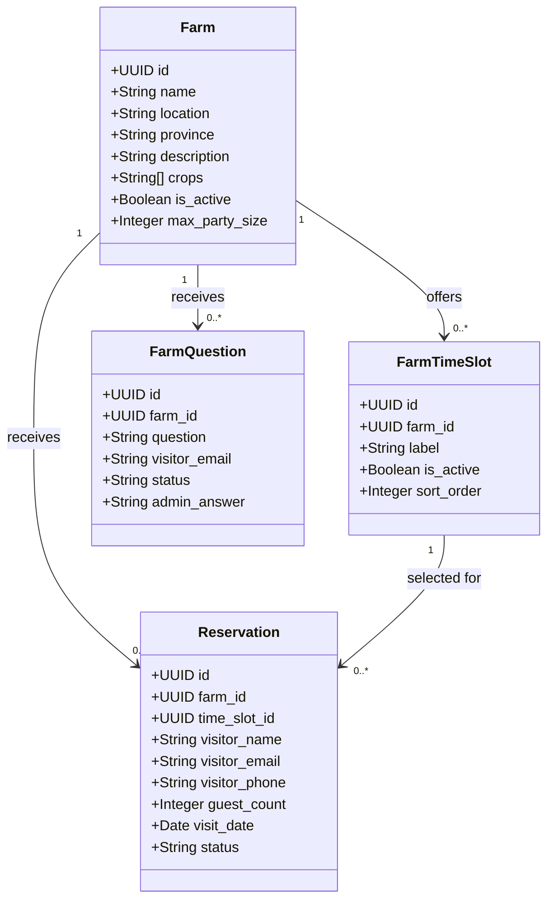
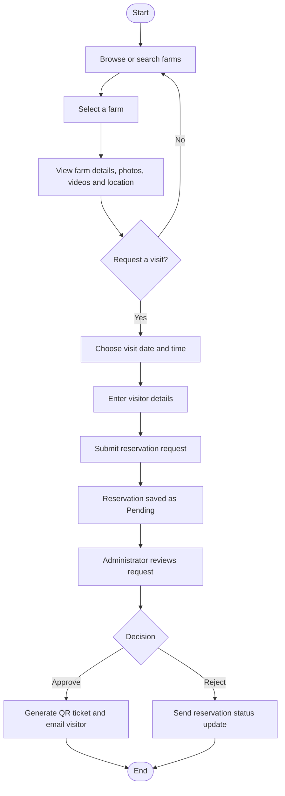
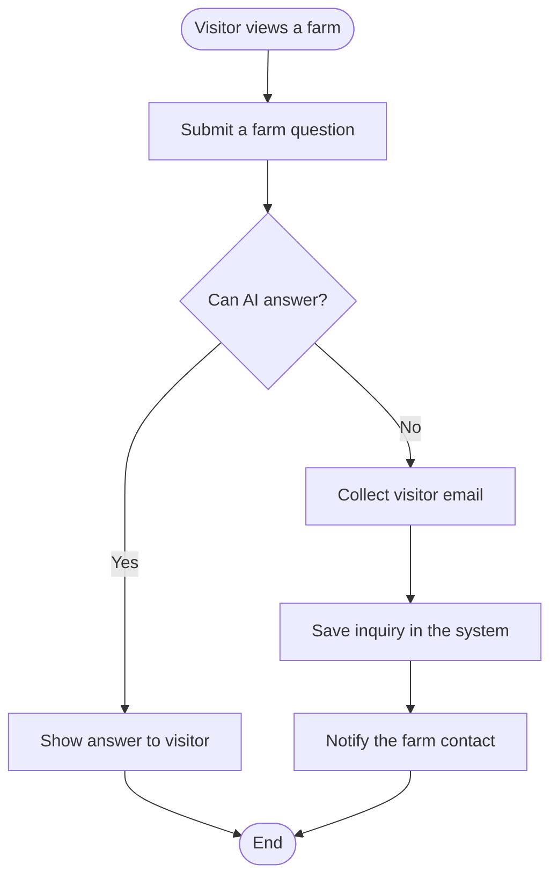
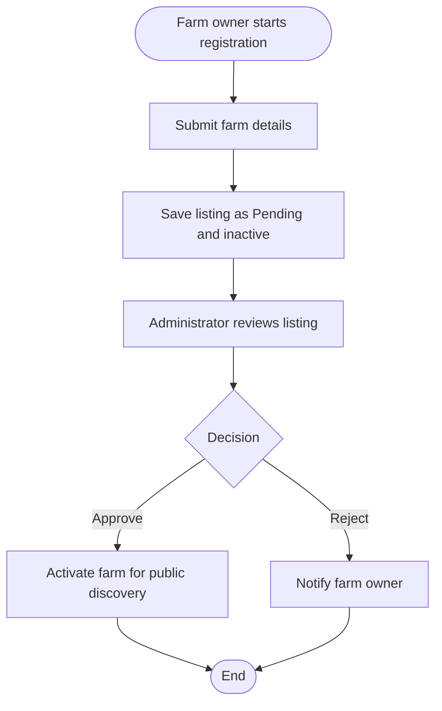

<p align="center">
  
</p>

<h1 align="center">SAGANA</h1>

<p align="center"><i>Discover. Explore. Experience.</i></p>

<p align="center">
  A farm tourism platform that helps travelers discover local farms and request visits across the Philippines.
</p>

<p align="center">
  
  
  
  
</p>

---

## Overview

**SAGANA** is a web-based farm tourism platform that brings farm discovery and visit requests into one place. Visitors can explore farms, learn about seasonal produce and activities, preview destinations through photos and videos, find locations on a map, and submit a visit request. Farm owners can submit their farm details for review and listing.

SAGANA aims to make farm experiences easier to discover while helping local farms increase their online visibility.

## Key Features

- **Farm discovery** – Browse and search farm listings, including seasonal and featured destinations.
- **Map and nearby farms** – Explore farm locations on an interactive map and find farms near your location.
- **Farm profiles** – View farm descriptions, crops, seasons, operating details, photos, videos, and directions.
- **Farm questions** – Ask questions about a farm through the on-page chat feature, with AI-assisted responses configured through OpenRouter.
- **Visit reservations** – Submit a visit request by selecting a farm, date, time slot, and visitor details. No visitor account is required.
- **Farm registration** – Submit a farm listing for administrator review.
- **Reservation updates and digital tickets** – Administrators review reservation requests; approved reservations receive a QR-code ticket by email.

> **Booking note:** Submitting a reservation is a request, not an instant confirmation. The reservation remains pending until an administrator reviews it.

## How It Works

**For visitors:** Discover a farm → Review its details → Choose a date and time → Submit visitor details → Receive an update after administrator review.

**For farm owners:** Submit farm information → Wait for administrator review → An approved farm can be published in the directory.

## Technology

| Area | Technology |
|---|---|
| Web framework | Next.js 16 |
| User interface | React 19 |
| Language | JavaScript |
| Database and backend services | Supabase (PostgreSQL) |
| Interactive map | Leaflet with OpenStreetMap tiles |
| Email notifications | Brevo |
| AI-assisted farm chat | OpenRouter |
| QR-code tickets | `qrcode` |

## System Diagrams

The diagrams below provide a simplified view of SAGANA's core data relationships and main user journeys. They focus on the parts most useful for understanding the system without reproducing every implementation detail.

### UML Class Diagram

This class diagram summarizes the main farm, time-slot, reservation, and question records used by the application. A reservation belongs to one farm and one time slot; a farm can have multiple time slots, reservations, and questions.



### Visitor Reservation Flow

The visitor journey is shown separately from farm-owner registration so the diagram remains readable at different screen sizes.



### Farm Question Flow



### Farm Registration Flow



## Run Locally

### Requirements

- Node.js 20 or newer
- npm
- A Supabase project
- A Brevo account with an API key and verified sender address
- An OpenRouter API key for AI-assisted farm chat (optional)

### Setup

1. **Clone the repository and install dependencies.**

   ```bash
   git clone <repository-url>
   cd sagana-farm-website-main
   npm ci
   ```

2. **Create the environment file.** Copy `.env.example` to `.env.local` and fill in the required values.

   ```bash
   cp .env.example .env.local
   ```

   On Windows Command Prompt:

   ```bat
   copy .env.example .env.local
   ```

3. **Configure Supabase.** Apply the SQL migrations in `supabase/migrations/` in filename order. Add farm records and their visitor-facing time slots. Set `is_active = true` for farms that should appear publicly.

4. **Start the development server.**

   ```bash
   npm run dev
   ```

5. Open [http://localhost:3000](http://localhost:3000).

### Environment Variables

| Variable | Purpose |
|---|---|
| `NEXT_PUBLIC_SUPABASE_URL` | Supabase project URL |
| `NEXT_PUBLIC_SUPABASE_ANON_KEY` | Supabase public/anonymous key |
| `SUPABASE_SERVICE_ROLE_KEY` | Server-only Supabase service-role key |
| `BREVO_API_KEY` | Brevo transactional email API key |
| `FARM_ADMIN_EMAIL` | Administrator email for reservation and farm-related notifications |
| `RESERVATION_FROM_EMAIL` | Verified sender address in Brevo |
| `APP_BASE_URL` | Application origin, such as `http://localhost:3000` |
| `RATE_LIMIT_SECRET` | Server-side secret used by request rate limiting |
| `OPENROUTER_API_KEY` | OpenRouter API key for AI-assisted farm chat |
| `OPENROUTER_MODEL` | Optional model ID; defaults to `openrouter/free` |

Keep credentials in `.env.local` or your hosting provider's environment settings. **Never commit secrets or expose `SUPABASE_SERVICE_ROLE_KEY` in client-side code.**

## Useful Commands

| Command | Purpose |
|---|---|
| `npm run dev` | Start the local development server |
| `npm run build` | Build the application for production |
| `npm run start` | Run the production build |
| `npm run lint` | Check code with ESLint |
| `npm test` | Run automated tests |
| `npm run test:integration` | Run integration tests |

---

## AI Assistance Disclosure

GitHub Copilot was used as an AI-assisted development tool to support selected coding, refinement, and debugging tasks. The development team reviewed and adapted its suggestions and remains responsible for the final implementation. SAGANA's AI-assisted farm chat is a separate application feature powered by OpenRouter.

---

## Development Team

| Developer | GitHub |
|---|---|
| Nikki C. Limboc | [](https://github.com/nikkibuttowsk) |
| Julian Carlo C. Magbuhat | [](https://github.com/juliancarlomagbuhat) |
| Christine Nicole P. Miranda | [](https://github.com/tinintinti) |

---

<p align="center">
  <b>SAGANA connects people to local farms, seasonal harvests, and meaningful countryside experiences.</b>
</p>
